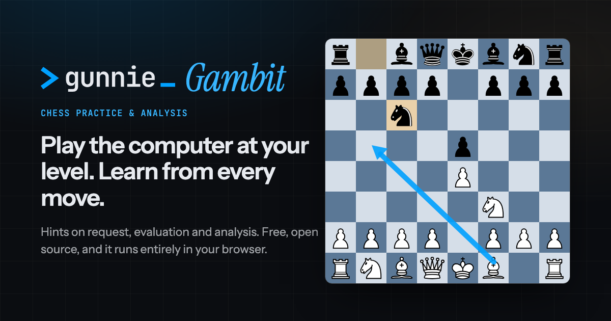

# Gunnie's Gambit

[](https://github.com/gunnie-agency/gunnies-gambit/actions/workflows/ci.yml)
[](LICENSE)

Practise chess against the computer at your own level, ask for hints, and analyse any position. Everything runs in
your browser: there is no backend, no account and no cookies.

**Try it: [chess.gunnie.nl](https://chess.gunnie.nl)**

[](https://chess.gunnie.nl)

## Features

- **Play** against the computer, from beginner level up to full strength. Hints on request; the evaluation and the
  best move (with engine lines) can each be switched on separately.
- **Analyse** any position: enter moves for both sides, see the best move, evaluation, top three lines and arrows.
- Tap a piece and then its square, or tap only the square when just one piece can go there. Or type moves in SAN
  (`Nf3`, `exd5`, `O-O`) or UCI (`e7e8q`).
- FEN and PGN import and export. The current game is remembered in your browser.
- Works on phones and desktop, dark and light theme, keyboard accessible (arrow keys move between squares).

## How it works

The engine is [Stockfish 19](https://stockfishchess.org/), compiled to WebAssembly (the 1.9 MB single-threaded "lite"
build), served from the same origin and run in Web Workers. Single-threaded means no `SharedArrayBuffer`, so the site
needs no cross-origin isolation headers and works on any static host.

Two workers run side by side: one analyses the position for hints and evaluation, the other plays the opponent at a
limited strength (`UCI_Elo`, or `Skill Level` with a shallow search for the beginner levels). Keeping them apart
means the opponent's handicap never leaks into the hints.

The interesting part is [`SearchQueue`](src/engine/queue.ts). UCI engines answer asynchronously, so when the position
changes during a search it sends `stop`, waits for that search's `bestmove`, and only then starts the newest request.
Output from stopped or superseded searches is dropped, so a suggestion is never shown for the wrong position, no
matter how fast moves are entered.

No UI framework: plain TypeScript modules, with all chess logic ([chess.js](https://github.com/jhlywa/chess.js)), UCI
parsing and score conversion in DOM-free modules covered by unit tests.

```
src/
  engine/   UCI worker wrapper, info parsing, search queue, strength levels
  board/    board rendering, arrows, promotion picker
  ui/       app controller, header and theme
  util/     SAN/UCI helpers, move input, score formatting
  state.ts  settings and game persistence (localStorage)
```

## Development

Requires Node.js 24 (see `.nvmrc`).

```bash
npm install          # also copies Stockfish and the piece set into public/
npm run dev          # http://localhost:5173
npm test             # unit tests (Vitest)
npm run lint         # ESLint; npm run format for Prettier
npm run build        # type check + production build in dist/
```

The display name and public URL live in [`.env`](.env). The build uses a relative base path, so `dist/` can be
served from any static host or sub-path.

## Deployment

Every push to `master` runs lint, format check, tests and build in [GitHub Actions](.github/workflows/ci.yml), and
when they pass, deploys `dist/` to [Cloudflare Workers](https://developers.cloudflare.com/workers/static-assets/) as a
static site ([`wrangler.jsonc`](wrangler.jsonc)). Pull requests get the same checks without the deploy. Caching and
security headers are in [`public/_headers`](public/_headers).

## Privacy

Your games, settings and analysis stay in your browser (`localStorage`); nothing about them is sent anywhere. To see
how many people use the site, production builds include
[Cloudflare Web Analytics](https://developers.cloudflare.com/web-analytics/), which counts page views without
cookies or personal data. It is added at build time from `VITE_CF_ANALYTICS_TOKEN` in [`.env`](.env); leave that
empty to build without it.

## Fair play

Gunnie's Gambit is for practice, games against computer bots and reviewing your own games. Using engine help in any
online game against a human, rated or casual, or in an over-the-board tournament is against the rules and gets
accounts banned on Chess.com and Lichess. It deliberately has no features for reading moves from other sites.

## License

GPL-3.0-or-later, see [LICENSE](LICENSE). Made by [Gunnie](https://gunnie.nl).

- [Stockfish](https://stockfishchess.org/) (GPL-3.0) via [stockfish.js](https://github.com/nmrugg/stockfish.js)
- [chess.js](https://github.com/jhlywa/chess.js) (BSD-2-Clause)
- Pieces by Colin M.L. Burnett, taken from [Chessground](https://github.com/lichess-org/chessground) (GPL-3.0-or-later)
- Fonts Instrument Sans, Instrument Serif and JetBrains Mono (SIL Open Font License) via
  [Fontsource](https://fontsource.org/)
